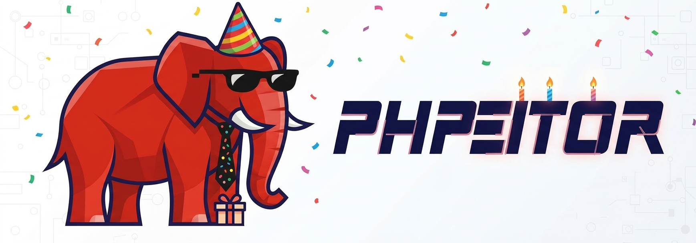

# Emma Heart 👧
[](https://www.linkedin.com/in/drphp/)
[](https://www.linkedin.com/in/drphp/)

[](https://www.youtube.com/watch?v=USQhEoqAP6c)  

## Descripción

**Heart of Emma** es la landing del cumpleaños número 6 de Emma: una experiencia estática e
interactiva con identidad visual gamer pixel/neón. Combina un video de fondo, la foto de
Emma en el centro, una órbita de nombres donde **EMMA** siempre resalta y un panel de
fiesta con pastel, velitas, globos, confeti y canción.

El proyecto no utiliza framework, bundler ni backend. Todo el comportamiento se resuelve
con HTML semántico, CSS moderno y JavaScript vanilla, por lo que puede servirse desde
Apache, cualquier servidor HTTP local o una CDN de archivos estáticos.

## Funcionalidades

- **Modo cumpleaños (6 años):** hero de celebración, figura «Número 6» y efecto `Fiesta` por defecto.
- **EMMA protagonista:** aparece 3 veces en posiciones equidistantes de la figura (0, 1/3 y 2/3 del recorrido), en mayúsculas, dentro de una
  pastilla rosa con estrellas, brillo y latido, siempre derecha y por encima de los demás
  nombres (que se atenúan levemente).
- **Foto circular perfecta:** recorte cuadrado con `object-fit: cover` centrado en la cara
  (la imagen original es vertical) e insignia «6» en la esquina. Al tocarla (o con `Enter`/`Espacio`)
  se abre una **tarjeta de cumpleaños animada** tipo polaroid: marco arcoíris que gira, zoom lento
  sobre la foto, destello, banderines, emojis flotando, título en ola, insignia de edad y confeti.
  Todo es CSS (sin GIF), toma nombre/edad/colores de `FIESTA_CONFIG` y se queda quieta con
  movimiento reducido o pausa.
- **Pastel interactivo como primera acción del panel:** seis velitas que se soplan con un toque
  o soplando al micrófono (solo en HTTPS). Al apagarlas todas cae confeti y suena «Cumpleaños feliz».
- **Canción sintetizada** con Web Audio (sin archivos de audio) con botón Cantar/Detener;
  se detiene al pausar la experiencia.
- **Globos** que suben por la pantalla y se revientan con un toque; premio cada 6 globos.
- **Confeti** en canvas al cargar, al reventar globos, al soplar velitas y al tocar la foto de Emma.
- Selección dinámica de seis trayectorias: número 6, corazón, estrella, círculo, triángulo y diamante.
- Cuatro atmósferas visuales: `Fiesta`, `Neon pulse` (tubos neón cian/rosa con pulso), `Arcade scan` y `Dreamy glow`.
- Transición suave al cambiar de figura: la órbita se desvanece y vuelve a entrar (~380 ms).
- Recuerda la última forma y efecto elegidos (`localStorage`, clave `emma-heart:prefs`).
- Pausa y reanudación de todas las animaciones, el video de fondo y las partículas del logo.
- Selección aleatoria del video de fondo entre `video1.mp4` y `video2.mp4`.
- Logo reutilizable con partículas, efecto de reacción y lightbox.
- Diseño responsive para escritorio, tablet y móvil.
- Soporte para `prefers-reduced-motion`.
- Controles con estados accesibles mediante `aria-pressed` y `aria-live`.

## Inicio rápido

### Requisitos

- Un navegador moderno con soporte para CSS Motion Path.
- Apache u otro servidor HTTP local recomendado.
- No se requiere Node.js ni instalación de dependencias.

### Ejecutar localmente

Clona el repositorio:

```bash
git clone https://github.com/phpeitor/emma-heart.git
cd emma-heart
```

Después sirve la carpeta desde Apache y abre:

```text
http://localhost/emma-heart/
```

También puedes abrir `index.html` directamente para revisar la interfaz, aunque `http://`
es la opción recomendada para garantizar la carga correcta de los recursos multimedia.

## Arquitectura

```text
emma-heart/
├── index.html              # Estructura semántica y controles de la experiencia
├── css/
│   ├── style.css           # Layout, responsive, efectos y estilos gamer pixel
│   ├── logo.css            # Componente visual reutilizable del logo
│   └── fiesta.css          # Pastel, velitas, globos y capa de confeti
├── js/
│   ├── index.js            # Órbita, figuras, efectos, video y controles
│   ├── logo.js             # Partículas, reacción y lightbox del logo
│   └── fiesta.js           # Confeti, globos, velitas, micrófono y canción
├── resources/
│   ├── emma.webp
│   ├── logo.png
│   ├── video1.mp4
│   └── video2.mp4
└── .ia-context/            # Reglas de contexto para asistentes de desarrollo
```

### Responsabilidades principales

- `index.html` define los puntos de integración que consume JavaScript: `orbit`,
  `centered-image`, `background-video`, `shape-controls`, `effect-controls` y
  `pause-control`.
- `css/style.css` controla la composición visual, la inversión de columnas en escritorio,
  el apilado responsive y los modificadores `data-effect`.
- `js/index.js` crea los nombres de forma segura, aplica la trayectoria seleccionada y
  actualiza el estado del panel.
- `css/logo.css` y `js/logo.js` forman un componente independiente que puede reutilizarse
  en otras landings.

## Personalización

### Nombres y figuras

Edita la lista `names` y el objeto `PATHS` en [js/index.js](./js/index.js). Los nombres
se insertan con `textContent`, por lo que no deben incluir HTML. `EMMA` no va en la lista:
se intercala automáticamente en posiciones equidistantes; cuántas veces aparece se controla con
`EMMA_REPEAT` (3 por defecto). El retraso de cada palabra es `--speed × índice ÷ --total`, así que
el reparto sigue siendo exacto aunque agregues o quites nombres. Su estilo está en `.love--highlight` de
[css/style.css](./css/style.css).

### Foto central

La foto se muestra como círculo con `aspect-ratio: 1` y `object-fit: cover`, así que acepta
imágenes verticales u horizontales sin deformarse. Si cambias la foto, ajusta el encuadre
con `object-position` en `#centered-image` (por defecto `50% 30%`, para centrar la cara).
El tamaño se define una sola vez en la variable `--photo-size`, que también usa la
insignia `.photo-badge`.

### Efectos visuales

Los efectos se registran en los botones de `index.html` y se aplican mediante
`body[data-effect="..."]` en [css/style.css](./css/style.css). Para añadir uno nuevo:

1. Agrega un botón con `data-effect`.
2. Añade su etiqueta en `effectLabels` dentro de `js/index.js`.
3. Define sus reglas visuales en CSS.

### Fiesta de cumpleaños

El nombre, la edad, los colores, el número de globos y la sensibilidad del micrófono se
configuran al inicio de [js/fiesta.js](./js/fiesta.js) en `FIESTA_CONFIG`. El componente
usa los elementos `confetti`, `balloon-layer`, `balloon-counter`, `[data-candle]`,
`cake-status`, `mic-control`, `song-control` y `relight-control`; si alguno falta, esa
parte simplemente no se activa. El botón del micrófono solo aparece en contexto seguro
(HTTPS o `localhost`).

### Logo reutilizable

Los emojis y la reacción del logo se configuran al inicio de [js/logo.js](./js/logo.js):

```js
const LOGO_CONFIG = {
  sparkEmojis: ['✨', '🎁', '🎉', '🎂'],
  reactionEmoji: '🥳',
  reactionClass: 'brain'
};
```

El componente requiere esta estructura mínima:

```html
<div class="logo" role="button" tabindex="0" aria-label="Abrir logo">
  <div class="box">
    
  </div>
</div>
```

## Accesibilidad y UX

- Los controles son botones nativos y exponen su estado con `aria-pressed`.
- El resumen de selección utiliza `role="status"` y `aria-live="polite"`.
- El logo y la foto de Emma pueden abrirse con clic, `Enter` o `Espacio`.
- El lightbox es un diálogo modal: el foco pasa al botón cerrar y vuelve al logo al cerrarse.
- El lightbox se cierra con botón, `Escape` o clic fuera.
- Los textos del panel en móvil no bajan de 8 px en tipografía pixel.
- Las animaciones respetan `prefers-reduced-motion`.
- Las imágenes incluyen texto alternativo descriptivo.

## Validación manual

Antes de publicar, comprueba:

- Que `video1.mp4`, `video2.mp4`, las imágenes y el logo responden sin errores 404.
- Que el panel permite cambiar las seis figuras (con transición suave) y los cuatro efectos.
- Que «Neon pulse» cambia visiblemente el aspecto y que la elección se conserva al recargar.
- Que pausar detiene también el video de fondo y las partículas del logo.
- Que la foto de Emma se ve como círculo perfecto, sin deformarse, en escritorio y móvil.
- Que EMMA aparece 3 veces y resalta sobre los demás nombres en las seis figuras y los cuatro efectos.
- Que las seis velitas se apagan, cae confeti, suena la canción y aparece «Encender».
- Que pausar también detiene la canción.
- Que los globos se revientan y nunca tapan el panel de control.
- Que pausar y reanudar conserva la selección actual.
- Que el logo funciona con ratón y teclado.
- Que la interfaz no genera scroll horizontal en móvil.
- Que la experiencia sigue siendo legible con movimiento reducido.

## Licencia y contribución

Este repositorio no declara todavía una licencia de distribución. Antes de reutilizarlo
fuera de un entorno personal, define la licencia correspondiente y verifica los derechos
de las imágenes, videos, tipografías y recursos externos.

Los cambios deben mantenerse enfocados, conservar las rutas relativas y actualizar esta
documentación cuando se modifique la estructura o el comportamiento público de la landing.
