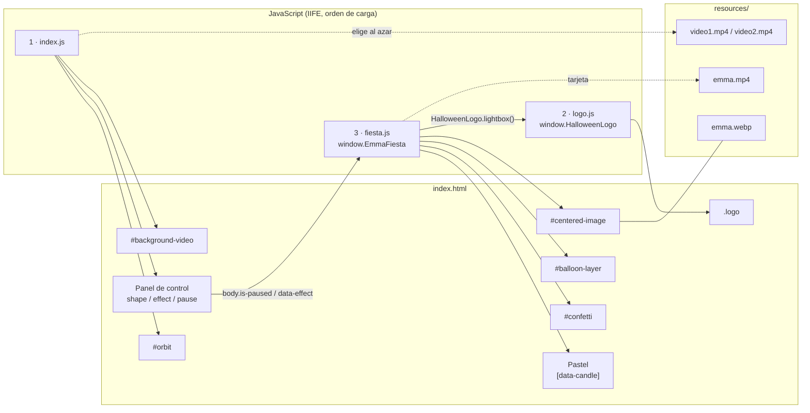
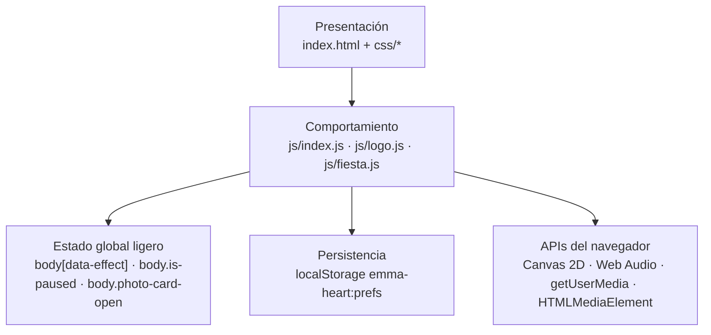
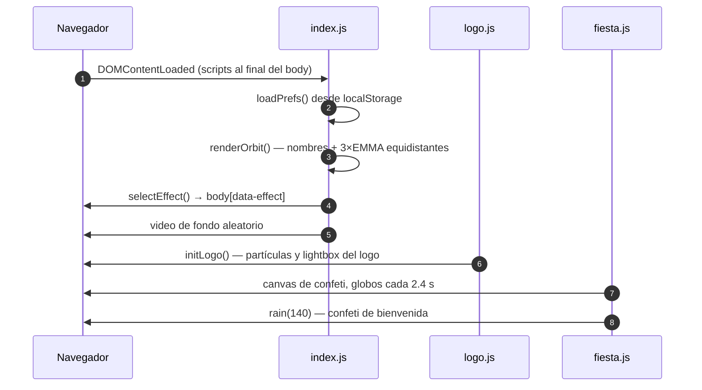
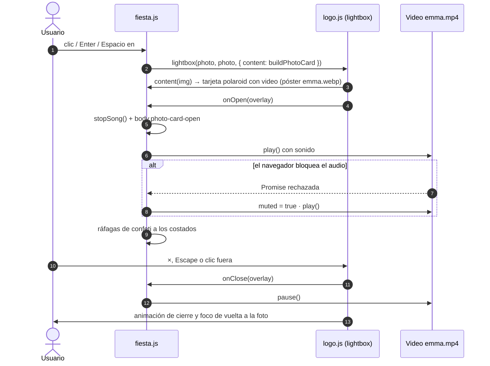
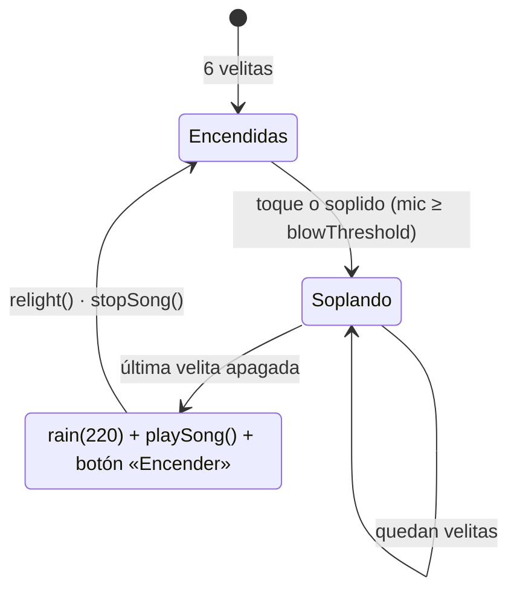
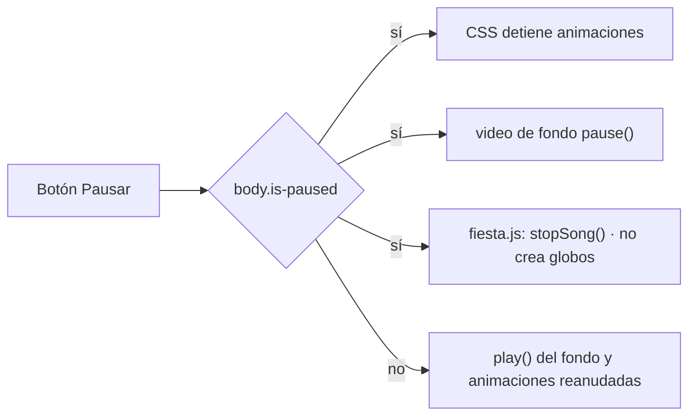

# Emma Heart 👧
[](https://www.linkedin.com/in/drphp/)
[](https://www.linkedin.com/in/drphp/)

[](https://www.youtube.com/watch?v=USQhEoqAP6c)  

> Landing estática e interactiva para el cumpleaños número 6 de Emma.
> **Zero dependencies · zero build · zero backend:** HTML semántico, CSS moderno y JavaScript vanilla.

## Tabla de contenido

- [Visión general](#visión-general)
- [Funcionalidades](#funcionalidades)
- [Inicio rápido](#inicio-rápido)
- [Arquitectura](#arquitectura)
- [Flujos principales](#flujos-principales)
- [Contratos entre módulos](#contratos-entre-módulos)
- [Personalización](#personalización)
- [Accesibilidad y rendimiento](#accesibilidad-y-rendimiento)
- [Checklist de validación](#checklist-de-validación)
- [Convenciones de contribución](#convenciones-de-contribución)
- [Licencia](#licencia)

## Visión general

**Heart of Emma** combina un video de fondo, la foto de Emma en el centro, una órbita de
nombres donde **EMMA** siempre resalta y un panel de fiesta con pastel, velitas, globos,
confeti y canción, todo con identidad visual gamer pixel/neón.

Decisiones de diseño:

| Decisión | Motivo |
|---|---|
| Sin framework ni bundler | El sitio se publica como archivos estáticos (Apache, CDN o `file://`), sin pipeline que mantener. |
| Módulos IIFE con `'use strict'` | Aislan el estado de cada componente sin necesidad de ES modules ni servidor con MIME correcto. |
| Componentes autocontenidos (`logo`, `fiesta`) | Se pueden copiar a otra landing junto con su CSS; si falta un elemento del DOM, esa parte no se activa. |
| CSS Motion Path para la órbita | La animación corre en el compositor; JS solo crea los nodos y calcula los retrasos. |
| Web Audio para la canción | Sin archivos de audio que descargar; la melodía se sintetiza nota a nota. |
| Configuración al inicio de cada módulo | `FIESTA_CONFIG`, `LOGO_CONFIG`, `names` y `PATHS` concentran todo lo personalizable. |

## Funcionalidades

- **Modo cumpleaños (6 años):** hero de celebración, figura «Número 6» y efecto `Fiesta` por defecto.
- **EMMA protagonista:** aparece 3 veces en posiciones equidistantes de la figura (0, 1/3 y 2/3 del
  recorrido), dentro de una pastilla rosa con estrellas, brillo y latido, siempre por encima de los
  demás nombres.
- **Foto circular perfecta:** recorte cuadrado con `object-fit: cover` centrado en la cara e insignia «6».
- **Tarjeta de cumpleaños con video:** al tocar la foto (o con `Enter`/`Espacio`) se abre un lightbox
  tipo polaroid que reproduce **`resources/emma.mp4`** en bucle y con sonido (la foto sirve de póster
  mientras carga). Marco arcoíris giratorio, destello, banderines, emojis flotando, título en ola,
  insignia de edad y confeti. Tocar el video lo pausa o reanuda; al cerrar se detiene.
- **Pastel interactivo:** seis velitas que se soplan con un toque o soplando al micrófono (solo en
  contexto seguro). Al apagarlas cae confeti y suena «Cumpleaños feliz».
- **Canción sintetizada** con Web Audio, con botón Cantar/Detener; se calla al pausar o al abrir el video.
- **Globos** que suben y se revientan con un toque; premio cada 6 globos.
- **Confeti** en canvas al cargar, al reventar globos, al soplar velitas y al abrir la tarjeta.
- **Seis trayectorias:** número 6, corazón, estrella, círculo, triángulo y diamante, con transición suave (~380 ms).
- **Cuatro atmósferas:** `Fiesta`, `Neon pulse`, `Arcade scan` y `Dreamy glow`.
- **Preferencias persistentes** en `localStorage` (clave `emma-heart:prefs`).
- **Pausa global** de animaciones, video de fondo, globos, canción y partículas del logo.
- **Video de fondo aleatorio** entre `video1.mp4` y `video2.mp4`.
- Responsive (escritorio, tablet y móvil) y soporte de `prefers-reduced-motion`.

## Inicio rápido

### Requisitos

- Navegador moderno con soporte para CSS Motion Path (`offset-path`).
- Un servidor HTTP estático (Apache, `python3 -m http.server`, etc.). No se requiere Node.js.

### Ejecutar localmente

```bash
git clone https://github.com/phpeitor/emma-heart.git
cd emma-heart
python3 -m http.server 8080   # o sirve la carpeta desde Apache
```

Abre `http://localhost:8080/` (o `http://localhost/emma-heart/` con Apache).

> Abrir `index.html` con `file://` funciona para revisar la interfaz, pero el micrófono exige
> HTTPS o `localhost`, y algunos navegadores restringen la reproducción de video con sonido.

## Arquitectura

### Estructura de carpetas

```text
emma-heart/
├── index.html              # Estructura semántica y puntos de integración del DOM
├── css/
│   ├── style.css           # Layout, responsive, órbita, efectos y estilo pixel
│   ├── logo.css            # Componente del logo y lightbox genérico
│   └── fiesta.css          # Pastel, globos, confeti y tarjeta con video
├── js/
│   ├── index.js            # Órbita, figuras, efectos, preferencias, pausa y video de fondo
│   ├── logo.js             # Partículas, reacción y lightbox reutilizable (window.HalloweenLogo)
│   └── fiesta.js           # Confeti, globos, velitas, micrófono, canción y tarjeta (window.EmmaFiesta)
├── resources/
│   ├── emma.webp           # Foto central (también póster del video)
│   ├── emma.mp4            # Video de la tarjeta de cumpleaños
│   ├── logo.png
│   ├── video1.mp4          # Fondos aleatorios
│   └── video2.mp4
└── .ia-context/            # Reglas de contexto para asistentes de desarrollo
```

### Mapa de componentes



### Capas y responsabilidades



El estado compartido entre módulos vive en **atributos y clases de `<body>`**, no en variables
globales: CSS reacciona a ellos y cada módulo los consulta cuando lo necesita.

## Flujos principales

### Carga inicial



### Tarjeta de cumpleaños con video



### Ciclo del pastel



### Pausa global



## Contratos entre módulos

| Contrato | Proveedor | Consumidor | Notas |
|---|---|---|---|
| `window.HalloweenLogo.lightbox(trigger, image, options)` | `logo.js` | `fiesta.js` | `options`: `modifier`, `closeLabel`, `content(img)`, `onOpen(overlay)`, `onClose(overlay)`. Si no existe, la foto solo lanza confeti. |
| `window.EmmaFiesta` → `{ burst, rain, playSong, stopSong }` | `fiesta.js` | Consola / otros scripts | Útil para depurar o disparar efectos desde fuera. |
| `body[data-effect]` | `index.js` | `style.css` | Valores: `party`, `neon`, `arcade`, `dream`. |
| `body.is-paused` | `index.js` | CSS, `fiesta.js`, `logo.js` | Pausa global. |
| `body.photo-card-open` | `fiesta.js` | `fiesta.css` | Sube el confeti por encima del lightbox. |
| IDs del DOM | `index.html` | Todos | `orbit`, `centered-image`, `background-video`, `video-source`, `confetti`, `balloon-layer`, `pause-control`, `cake-status`, `mic-control`, `song-control`, `relight-control`. |

## Personalización

### Nombres y figuras

Edita `names` y `PATHS` en [js/index.js](./js/index.js). Los nombres se insertan con
`textContent` (sin HTML). `EMMA` no va en la lista: se intercala automáticamente
`EMMA_REPEAT` veces (3 por defecto). El retraso de cada palabra es
`--speed × índice ÷ --total`, así que el reparto es exacto aunque cambies la lista.

### Fiesta y tarjeta

Todo se configura al inicio de [js/fiesta.js](./js/fiesta.js):

```js
const FIESTA_CONFIG = {
  name: 'Emma',
  age: 6,
  colors: ['#ff3e9d', '#45e8e0', '#ffe66d', '#b9a4ff', '#9dff9a', '#ff9a5c'],
  maxBalloons: 6,
  balloonEveryMs: 2400,
  blowThreshold: 0.2 // volumen (0–1) que cuenta como soplido
};
const CARD_VIDEO = './resources/emma.mp4';
```

Para cambiar el video de la tarjeta, reemplaza `resources/emma.mp4` o apunta `CARD_VIDEO` a
otro archivo. Recomendado: H.264 + AAC, proporción cercana a 4:5 (el marco es `aspect-ratio: 4 / 5`),
`faststart` para que empiece antes de terminar la descarga y menos de ~6 MB:

```bash
ffmpeg -i original.mp4 -vf "scale=848:-2" -c:v libx264 -crf 24 -preset slow \
       -c:a aac -b:a 128k -movflags +faststart resources/emma.mp4
```

### Foto central

Acepta imágenes verticales u horizontales sin deformarse. Ajusta el encuadre con
`object-position` en `#centered-image` (por defecto `50% 30%`). El tamaño vive en `--photo-size`.

### Efectos visuales

1. Agrega un botón con `data-effect` en `index.html`.
2. Registra su etiqueta en `effectLabels` (`js/index.js`).
3. Define sus reglas bajo `body[data-effect="..."]` en `css/style.css`.

### Logo reutilizable

```js
const LOGO_CONFIG = {
  sparkEmojis: ['✨', '🎁', '🎉', '🎂'],
  reactionEmoji: '🥳',
  reactionClass: 'brain'
};
```

```html
<div class="logo" role="button" tabindex="0" aria-label="Abrir logo">
  <div class="box"></div>
</div>
```

## Accesibilidad y rendimiento

**Accesibilidad**

- Controles nativos con `aria-pressed`; resumen con `role="status"` y `aria-live="polite"`.
- Foto y logo operables con clic, `Enter` o `Espacio`.
- Lightbox modal (`role="dialog"`, `aria-modal`): foco en «cerrar», `Tab` atrapado, cierre con
  `Escape`, botón o clic fuera, y el foco vuelve a quien lo abrió.
- El video de la tarjeta tiene `aria-label` descriptivo.
- `prefers-reduced-motion` desactiva animaciones decorativas y los globos.

**Rendimiento**

- La órbita usa `offset-path` + `transform`, animados en el compositor.
- El confeti se dibuja en un solo `<canvas>` con `requestAnimationFrame` y se detiene sin partículas.
- Los globos no se generan con la pestaña oculta ni en pausa.
- El video de la tarjeta se crea solo al abrirla y se pausa al cerrarla.

## Checklist de validación

- [ ] `video1.mp4`, `video2.mp4`, `emma.mp4`, `emma.webp` y `logo.png` responden sin 404.
- [ ] Las seis figuras cambian con transición suave y los cuatro efectos se aplican.
- [ ] La figura y el efecto elegidos se conservan al recargar.
- [ ] EMMA aparece 3 veces y resalta en todas las figuras y efectos.
- [ ] La foto se ve como círculo perfecto en escritorio y móvil.
- [ ] Al tocar la foto, la tarjeta reproduce `emma.mp4` con sonido, la canción se calla y al cerrar el video se detiene.
- [ ] Las seis velitas se apagan, cae confeti, suena la canción y aparece «Encender».
- [ ] Pausar detiene animaciones, video de fondo, canción y globos; reanudar conserva la selección.
- [ ] Los globos se revientan y nunca tapan el panel.
- [ ] Logo y foto funcionan con ratón y teclado.
- [ ] Sin scroll horizontal en móvil y legible con movimiento reducido.

## Convenciones de contribución

- Ramas `feature/<tema>` hacia `main` mediante PR.
- Commits en español con [Conventional Commits](https://www.conventionalcommits.org/es/) (`feat:`, `fix:`, `docs:`, `chore:`).
- Mantener rutas relativas y la lógica de cumpleaños en `fiesta.js`/`fiesta.css` (no mezclarla en `index.js`).
- Los originales pesados van en `resources/originales/` (ignorado por git); solo se publican versiones optimizadas.
- Actualizar este README cuando cambie la estructura o el comportamiento público.

## Licencia

Este repositorio no declara todavía una licencia de distribución. Antes de reutilizarlo fuera
de un entorno personal, define la licencia y verifica los derechos de imágenes, videos,
tipografías y recursos externos.
